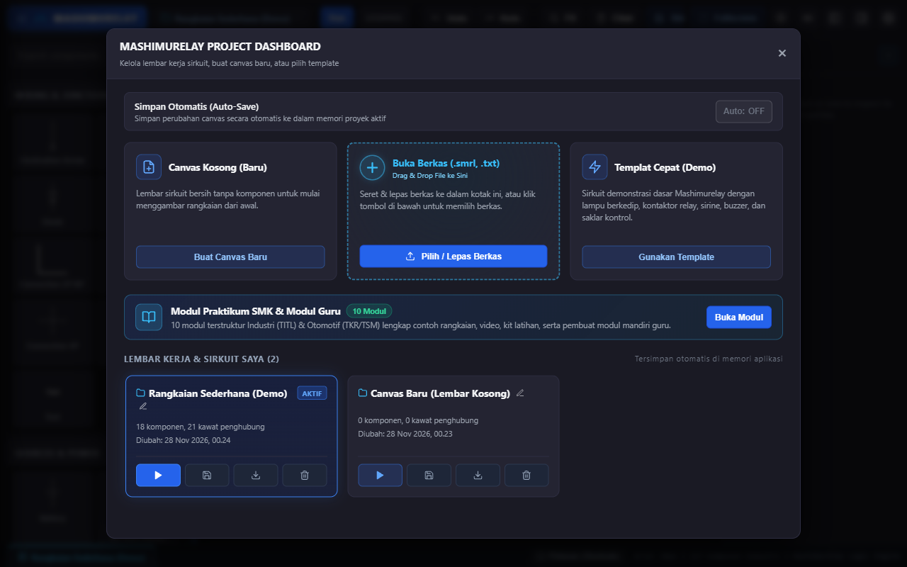

<p align="center">
  <a href="https://github.com/maulana-mash/Mashimurelay.web">
    
  </a>
</p>

<h1 align="center">Mashimurelay Web</h1>

<p align="center">
  <strong>Simulator CAD Kontrol Relay Elektromekanikal &amp; Motor Listrik Industri Berbasis Web (IEC 60617)</strong><br />
  Perangkat lunak CAD dan simulator rangkaian listrik waktu nyata 60 FPS tanpa pustaka eksternal dengan Equipotential Graph Solver (AC 1-fasa, AC 3-fasa, DC), 117 simbol vektor industri, dan dukungan PWA offline-first.
</p>

<p align="center">
  
  
  
  
</p>

<p align="center">
  <a href="#pratinjau-antarmuka">Pratinjau</a> &bull;
  <a href="#kapabilitas-rekayasa-utama">Fitur Utama</a> &bull;
  <a href="#pustaka-komponen-standar-iec-60617-117-simbol">117 Komponen</a> &bull;
  <a href="#ekosistem-lintas-platform">Ekosistem</a> &bull;
  <a href="#cara-menjalankan-lokal">Cara Menjalankan</a> &bull;
  <a href="#lisensi--hak-cipta">Lisensi</a>
</p>

---

## Pratinjau Antarmuka

<p align="center">
  
</p>

<p align="center">
  <sub>Tampilan Mashimurelay Web Dashboard: buat kanvas baru, unggah berkas `.smrl`, akses 10 modul praktikum SMK &amp; modul guru, serta jalankan rangkaian demonstrasi siap pakai.</sub>
</p>

---

## Ringkasan Proyek

**Mashimurelay** adalah perangkat lunak Computer-Aided Design (CAD) dan simulator waktu nyata (*real-time*) untuk perancangan rangkaian kontrol relay elektromekanikal serta instalasi motor listrik industri berstandar **IEC 60617**.

Dirancang khusus untuk kebutuhan pendidikan vokasi, pelatihan ketenagalistrikan, dan rekayasa otomasi industri, Mashimurelay mengintegrasikan **Discrete-Event Equipotential Graph Solver** dengan iterasi titik tetap (*fixed-point iteration*) untuk menyelesaikan topologi rangkaian AC 1-fasa, AC 3-fasa, maupun DC secara presisi pada 60 FPS tanpa dependensi pustaka eksternal.

---

## Kapabilitas Rekayasa Utama

### 1. Discrete-Event Equipotential Circuit Solver
- **Multi-Rail Bitmask Propagation:** Melacak distribusi potensial `L1`, `L2`, `L3`, `N`, `PE`, `DC+`, dan `DC-` secara simultan melalui *Breadth-First Search* (BFS) pada graf konduktif.
- **Series & Parallel Load Resolution:** Menyelesaikan pembagian arus pada beban pasif 2-terminal seri maupun paralel via *Depth-First Search* (DFS), termasuk konduksi searah pada dioda (*forward-bias* vs *reverse-bias*).
- **Fixed-Point Convergence Loop:** Mengevaluasi umpan balik instan antara koil kontaktor, relay tunda waktu (*timer*), kontak bantu (*auxiliary contacts*), dan *interlock* mekanis hingga mencapai titik ekuilibrium dalam satu siklus frame.
- **Fault & Thermal Protection Modeling:** Mendeteksi hubung singkat antar-fasa, fasa-ke-netral, dan panas berlebih DC, lengkap dengan peleburan sekring (*fuse*) serta pengujian *trip* pada *Thermal Overload Relay*.

### 2. Perangkat Pedagogis & Produktivitas Teknik
- **Kit Praktikum Guru (*Teacher Lock Mode*):** Mengunci posisi dan properti komponen tertentu pada soal praktikum siswa, dilengkapi ekspor/impor kode QR terenkripsi.
- **Generator Laporan PDF Teknis:** Menghasilkan dokumen laporan PDF A4 potret lengkap dengan pin IEC/DIN, etiket Nilai/Paraf, dan daftar komponen (*Bill of Materials*).
- **Modul & Templat Industri Bawaan:** Menyediakan rangkaian standar siap uji seperti *Direct On-Line (DOL) Starter*, *Forward-Reverse Interlock*, dan *Automatic Star-Delta Starter*.
- **Ensiklopedia & Panduan Interaktif:** Referensi teknis internal tiap komponen beserta panduan penggunaan ruang kerja CAD.

---

## Pustaka Komponen Standar IEC 60617 (117 Simbol)

| Kategori | Cakupan Komponen Utama |
| :--- | :--- |
| **Sources** | Suplai Fasa (`L1`, `L2`, `L3`, `3P`, `3P+N`), Netral (`N`), Ground (`PE`), Suplai DC (`+`, `-`, Battery), Power Supply AC/DC (1P & 3P), Generator 3-Fasa (Manual & Auto Control `C1-C2`). |
| **Protections** | MCB (1P–4P), Thermal-Magnetic Breaker, MPCB, RCCB, RCBO, Fuse (1P–3P + N), Fuse-Switch Disconnector, Isolator, Thermal Overload Relay (1P–3P dengan *Test-Trip*). |
| **Switches** | Saklar Manual (`NO`, `NC`, `CON`), Saklar Selektor 3-Posisi (`I-0-II` & `I-II-III`), Pushbutton (`NO`, `NC`, `CON`, `NONC`, `Crossover`), Emergency Stop, Limit, Roller, Pedal, Key, Pressure, Temperature, Float, Flow, & Proximity Sensor. |
| **Contactors** | Kontaktor Daya Utama `NO` dan `NC` (1P hingga 4P) dengan sinkronisasi tag koil (`-KM`). |
| **Coils & Timers** | Koil Kontaktor Standar, Latching Relay, Solenoid, On-Delay Timer (`KT`), Off-Delay Timer, On-Off Delay Timer, Flasher/Blinker Relay, dan Phase Failure Relay (`PFR`). |
| **Auxiliaries** | Kontak Bantu Instan (`NO`, `NC`, `CON`, `NONC`), Kontak Bantu Tunda Waktu (*On-Delay*, *Off-Delay*, *On-Off Delay*), serta Kontak Bantu *Thermal Overload* (`95-96` NC & `97-98` NO). |
| **Motors** | Motor Induksi 3-Fasa (`U1, V1, W1`), Motor 3-Fasa 6-Terminal *Star-Delta*, Motor Dahlander 2-Kecepatan, Motor 2-Belitan Terpisah, Motor Induksi 1-Fasa, dan Motor DC (CW/CCW). |
| **Loads** | Lampu Indikator 5 warna, Lampu Kedip, Buzzer, Siren, dan Bell dengan sintesis Web Audio API. |
| **Others** | Terminal Block, Junction Node, *Cross-Reference Arrows* (`-REF1`), Dioda Penyearah, dan Anotasi Teks CAD. |

---

## Ekosistem Lintas Platform

Format berkas proyek Mashimurelay (`.smrl` / `.srelay`) kompatibel penuh antar-platform:

1. **[Mashimurelay Web](https://github.com/maulana-mash/Mashimurelay.web)** (`PWA & Online Simulator`) — **Repositori ini.**
2. **[Mashimurelay Windows Desktop](https://github.com/maulana-mash/Mashimurelay.exe)** (`Rust Tauri v2 Desktop`) — Stasiun kerja instruktur dengan microserver Hotspot LAN offline dan edisi Portable/NSIS Installer.
3. **[Mashimurelay Android](https://github.com/maulana-mash/Mashimurelay.apk)** (`100% Pure Kotlin Native`) — Aplikasi mobile native GPU Canvas 60–120 FPS tanpa WebView untuk perangkat siswa.

---

## Cara Menjalankan Lokal

Proyek ini tidak membutuhkan instalasi dependensi eksternal (`npm install` tidak diperlukan untuk menjalankan aplikasi).

### Opsi 1: Mode Jendela Aplikasi Mandiri (Windows)
```powershell
.\run-webview-app.bat
```

### Opsi 2: Mode Browser Standar
```powershell
.\run-browser.bat
# atau menggunakan Python langsung:
python serve.py
```
Buka `http://localhost:8080` di peramban Anda.

### Pipeline Build & Minifikasi Produksi (`src_dev/` -> `dist/` & `public/`)
```powershell
node scripts/build-secure.js
```

---

## Struktur Direktori

```text
mashimurelay-web/
├── src_dev/                  # Kode sumber pengembangan (index.html, components.json, css/, js/)
├── assets/                   # Logo, simbol vektor SVG, & tangkapan layar dokumentasi
├── dist/                     # Bundel produksi teroptimasi (hosting statis)
├── public/                   # Cermin bundel statis
├── scripts/                  # build-secure.js & build-dist.js
├── manifest.json             # Manifes Progressive Web App (PWA)
└── sw.js                     # Offline-first Service Worker
```

---

## Lisensi & Hak Cipta

Hak Cipta (c) 2026 **Mashimurelay Engineering Project (Mash Maulana)**. Seluruh hak dilindungi undang-undang.

> **Keterangan Standar & Orisinalitas Aset:** Seluruh 117 simbol skematik kelistrikan mengacu pada standar internasional publik **IEC 60617 / DIN EN 60617** dan dihasilkan mandiri sebagai vektor SVG *clean-room*. Mesin simulasi *equipotential graph*, isolasi gangguan per-jalur, proteksi *auto-trip*, *Teacher Lab Mode*, dan sintesis audio interaktif merupakan implementasi rekayasa orisinal Mashimurelay.
